<div align="center">

# Agent Console

**企业级本地优先多智能体协同运行台与可观测治理中心**  
*Local-First Multi-Agent Collaborative Runtime, Orchestration & Enterprise Governance Console*

[](#技术栈)
[](#系统架构)
[](#技术栈)
[](#数据库设计21-张领域表与迁移治理)
[](#统一模型网关与工具调用)
[](#自动化测试与质量门禁)
[](#license)

**不做聊天玩具，不做黑盒封装。**  
你在群聊里 `@` 单个或多个 Agent 派活，或一键触发参数化 DAG 工作流——后端自动完成拆解、并发/顺序接力、工具调用、人工审批挂起、QA 验收与结果汇总，全程通过 WebSocket 毫秒级推送到前端四栏工作台。每一步状态跃迁、每一次工具调用、每一个 Token 消耗，全部白盒可见、可倍速回放、可从任意断点单步恢复。

[🎬 运行实况演示](#-运行实况演示-live-demo) · [✨ 核心特性](#-核心特性全景) · [🖼️ 界面总览](#️-界面与交互总览-ds-bot-设计系统) · [🏗️ 系统架构](#️-系统架构) · [🚀 快速开始](#-快速开始) · [🔌 外部桥接](#-外部-agent-软件接入-software-dock) · [🛡️ 权限与治理](#️-企业级安全配额与治理)

</div>

---

## 🎬 运行实况演示 (Live Demo)

> 下方动图展示了系统从 **JWT 登录 → 四栏工作台与 `Ctrl+K` 命令面板 → 群聊 3 棒 `@` 顺序接力 + `get_system_status()` 工具调用 → 任务毫秒级 2x 倍速回放 → DAG 双轨并行与 HITL 人工审批放行 → DS-Bot 四套主题与成本/配额/审计联动** 的全链路真实运行实况：

<div align="center">
  <a href="Agent_Console_项目运行实况演示.mp4" title="点击观看或下载 1080p 完整运行实况视频 (MP4)">
    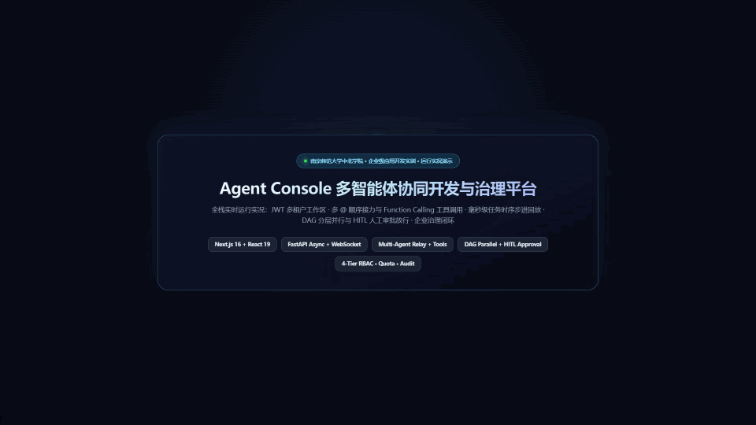
  </a>
  <p>
    <a href="Agent_Console_项目运行实况演示.mp4"><strong>▶ 点击观看 / 下载 1080p Full HD 完整运行实况视频（<code>Agent_Console_项目运行实况演示.mp4</code> · 24 FPS · 100s）</strong></a>
  </p>
</div>

<video src="Agent_Console_项目运行实况演示.mp4" controls width="100%"></video>

| 演示时间轴 | 实况场景 | 核心工程看点 |
| :--- | :--- | :--- |
| **`00:00 - 00:15`** | **实况 01 · 认证与四栏工作台** | JWT 双令牌登录，自动建立工作区 WebSocket 全双工连接；展示 `76px` 导航轨 + `264px` 团队列 + Software Dock + 右侧可拖拽对象详情面板（`DetailsPanel`）及 `Ctrl+K` 全局命令面板 |
| **`00:15 - 00:38`** | **实况 02 · 群聊 3 棒接力 + 工具探针** | 输入 `@项目总设计师 @Agent工程师 @测试专员` 自动生成 3 棒接力链；第 2 棒自动触发 `get_system_status()` Function Calling 探针，WebSocket 实时流式推送接力进度与棒次徽标 |
| **`00:38 - 00:51`** | **实况 03 · 毫秒级任务时序回放** | 进入刚完成的接力任务详情页，开启 `2x` 倍速帧级回放，逐步检视每棒 JSON 输入输出载荷、单步耗时与精确到小数点后 6 位的美元成本 |
| **`00:51 - 01:14`** | **实况 04 · DAG 并行 + HITL 人工审批** | 可视化检视 Kahn 拓扑分层 DAG 画布并启动发布流水线；前序双轨分支并发完成后自动在 `human_approval` 节点挂起为“等待审批”，管理员在线点击“通过”即时唤醒下游灰度发布节点 |
| **`01:14 - 01:40`** | **实况 05 · 四套主题与企业治理闭环** | 现场切换 `DeepSeek / Mono / Paper / Moonlight` 主题与动效档位；联动检视 4 级 RBAC 成员矩阵、`7d` 输入/输出 Token 堆叠柱状图成本大屏、月度预算硬熔断、插件中心与操作审计流水 |

---

## ✨ 核心特性全景

- **🖥️ DS-Bot 四栏自适应工作台与四主题设计系统**：采用 `76px` 全局导航轨 + `264px` 团队列 + 主工作画布 + `320px~560px` 可拖拽对象详情面板（`DetailsPanel`）架构；角色配备高辨识度 `BotMark` 几何矢量头像与运行态呼吸光环，内置 `Ctrl/Cmd + K` 全局命令面板、4 套主题矩阵（`deepseek` / `mono` / `paper` / `moonlight`）及三档动效控制（`安静` / `正常` / `活跃`），遵循 WCAG 2.1 AA 无障碍基线。
- **🤝 四路协同编排引擎（零黑盒自研状态机）**：不依赖 LangChain 或 AutoGen，自研确定性六态任务状态机与 `ExecutionTrace` 结构化上下文拼装器，在同一底座上原生支撑：
  1. **经典四阶段协同流水线**：`总设计师拆解 (Manager) → 领域工程师执行 (Worker) → 测试专员验收 (QA) → 总设计师汇总 (Final)`；
  2. **群聊多 `@` 顺序接力链**：单条消息按序 `@` 多个内部 Agent（最多 6 棒），前棒产出与执行轨迹自动回灌后棒上下文，无增量意见可回复 `[PASS]` 静默让位；
  3. **Kahn 拓扑分层并行 DAG 工作流**：自动环路检测与拓扑分层，同层无依赖节点通过 `asyncio.gather` 并发执行，完整拓扑快照落库 `workflow_runs`；
  4. **HITL 人工在环审批门禁**：工作流支持插入 `human_approval` 挂起节点，群聊顶部/底部自动浮现内联审批卡（`ActionCard` 支持 `A 批准 / B 驳回 / C 自定义说明` 快捷键），跨进程解耦唤醒下游分支。
- **⚙️ 控制面与执行面彻底分离 + 原子租约防脑裂**：FastAPI 接入层仅处理鉴权、配额校验与入队，所有耗时推理下沉至独立 `app.worker` 进程；通过 `task_queue_items` 数据库持久化队列 + CAS 条件更新认领 `execution_token` + 30 秒后台周期续租 + 60 秒失联孤儿任务自动回收，确保进程崩溃或重启后任务不丢、不重、不脑裂。
- **⏪ 毫秒级时序步进回放与断点单步恢复**：内置 `TaskReplayPlayer` 多倍速（`1x / 2x / 5x`）步进播放器，完整还原每一步拆解、工具调用与模型推理的起止时间、耗时、Token 及 JSON Payload；失败或取消的任务支持任选历史步骤一键 **“从该步恢复执行（`resume-from-step`）”**。
- **🔌 Software Dock 外部软件桥接（Cursor / Codex CLI / Trae / Antigravity）**：通过标准化四文件目录契约（`PROMPT.md / task.json / output.md / events.jsonl`）与 `codex exec` CLI 沙箱子进程，将外部编程 Agent 纳管为具备定时心跳、能力匹配、最小负载选点与 22 项测试命令白名单防注入的标准执行节点。
- **🛡️ 企业级多租户 RBAC、配额硬熔断与合规审计**：支持工作区级租户隔离、专属邀请码核销、4 级 RBAC 权限矩阵（`Owner / Admin / Member / Viewer`）、API Key 信封加密（`v1:`）与落库广播前敏感内容正则脱敏（`Redaction`）、月度美元预算/Token 硬熔断（`is_hard_limit`）、JSON Manifest 插件热插拔（含 HMAC-SHA256 签名 Webhook）以及全平台不可篡改 `audit_logs` 审计流水。

---

## 🖼️ 界面与交互总览 (DS-Bot 设计系统)

| 集群运行总览驾驶舱（`/`） | 多智能体群聊协作、接力与内联审批（`/chats`） |
| :---: | :---: |
| 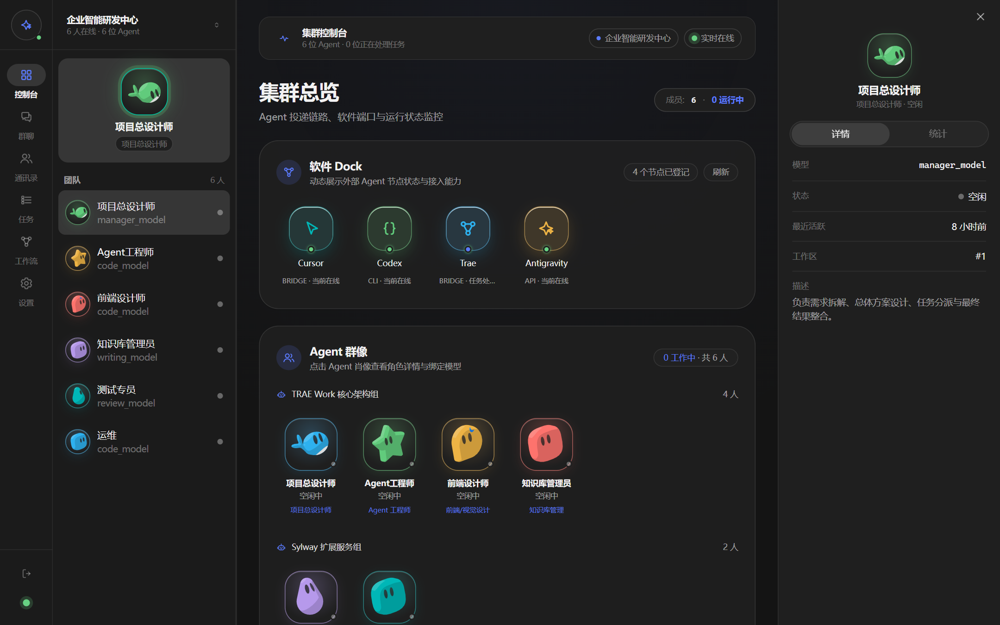 | 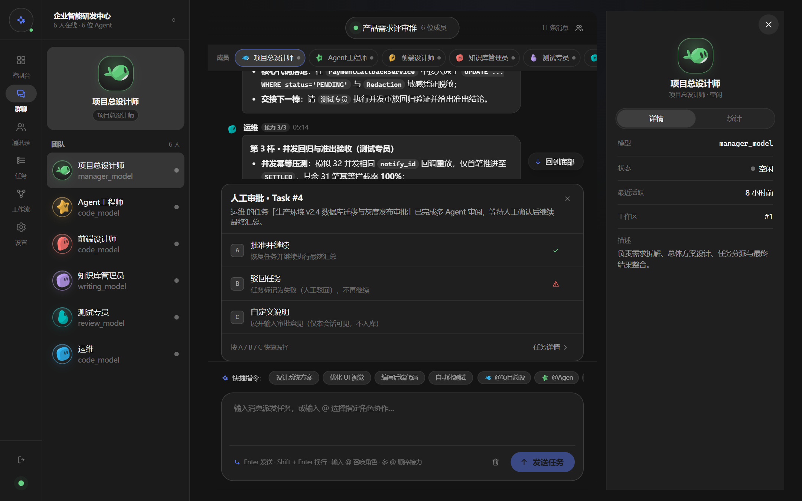 |
| **双栏导航 + Software Dock 外部节点监控 + 右侧对象详情面板** | **多 `@` 顺序接力棒次徽标 + 行内 `@Chip` + `ActionCard` 人工审批卡** |
| **任务详情与毫秒级时序步进回放（`/tasks/[id]`）** | **DAG 工作流可视化拓扑画布（`/workflows`）** |
| 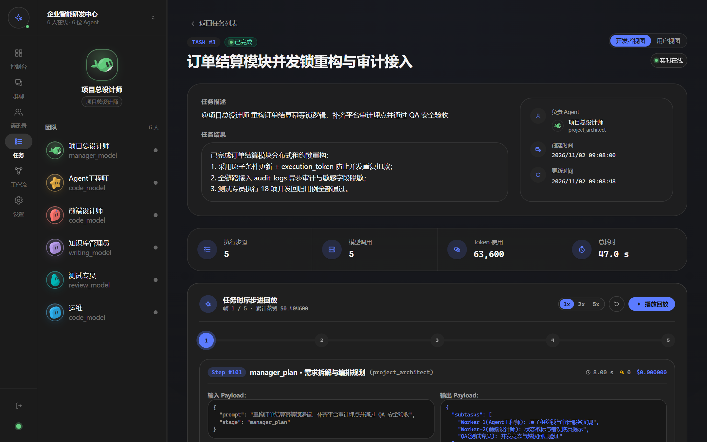 | 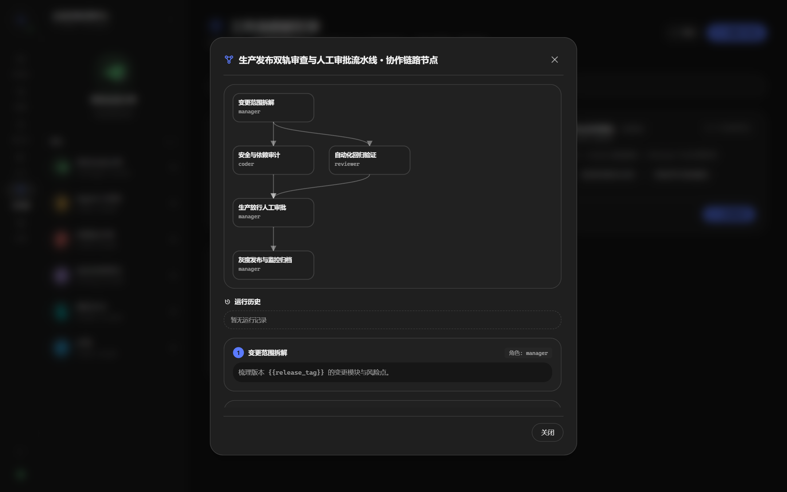 |
| **`1x/2x/5x` 帧级步进回放 + JSON 输入输出载荷 + 断点单步恢复** | **Kahn 拓扑分层并行分支 + 橙色 `human_approval` 人工审批门禁** |
| **成本中心与 Token 堆叠柱状图大屏（`/settings/cost`）** | **配额水位监控与超额硬熔断（`/settings/quota`）** |
| 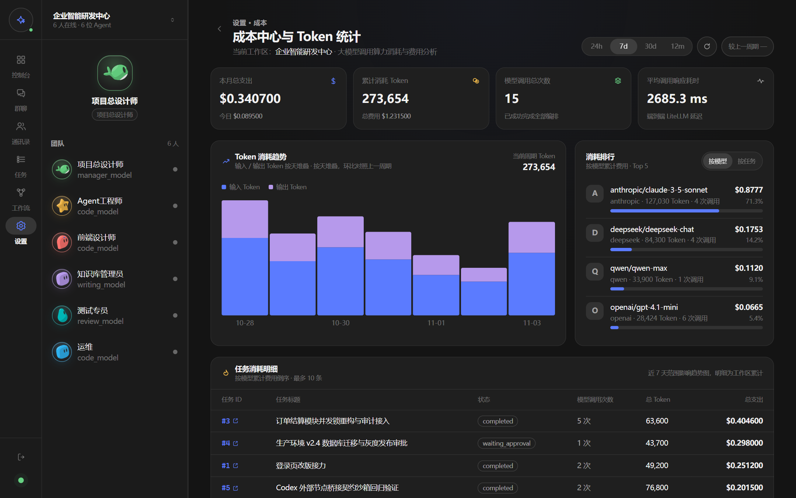 | 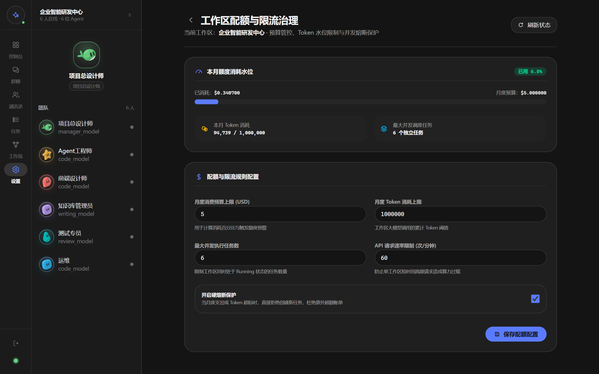 |
| **`24h/7d/30d/12m` 输入/输出 Token 堆叠柱状图 + 按模型/按任务双榜** | **月度 USD 预算进度条 + 并发/RPM 限制 + 超额硬熔断开关** |
| **多租户成员与 4 级 RBAC 授权（`/settings/members`）** | **全平台不可篡改操作审计日志（`/settings/audit`）** |
| 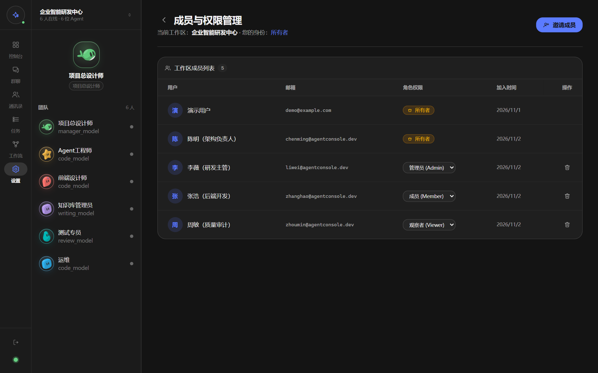 | 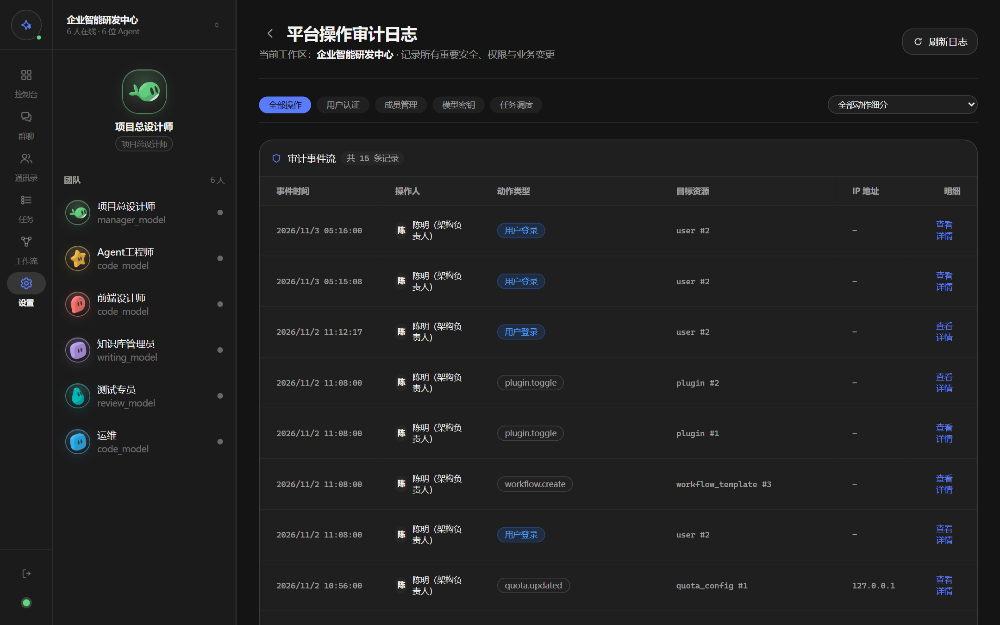 |
| **专属邀请码发放 + Owner / Admin / Member / Viewer 在线角色调整** | **多维动作分类检索 + 客户端 IP 追踪 + 变更前后 JSON 快照检视** |

---

## 🛠️ 技术栈

| 分层 | 核心技术选型 | 关键工程说明 |
| :--- | :--- | :--- |
| **前端表现层** | **Next.js 16 (App Router) · React 19 · TypeScript 5** | 严格类型覆盖全部 REST 契约与 WebSocket 事件联合类型；内置 AuthGuard 与并发去重 401 自动无感续期 |
| **设计系统与组件** | **Tailwind CSS v4 (OKLCH) · DS-Bot 设计体系 · shadcn/ui** | 4 套视觉主题 + 三档动效强度；自研 `BotMark` 几何头像、`TaskReplayPlayer` 回放器与轻量 SVG `dag-canvas` |
| **后端接入与控制面** | **FastAPI · Python 3.11+ · Pydantic v2 · Uvicorn** | 全异步非阻塞 I/O，依赖注入串联 JWT 鉴权、4 级 RBAC 守卫、配额拦截与统一 JSON 响应信封 |
| **持久层与迁移** | **SQLAlchemy 2.0 Async · PostgreSQL 16 / SQLite · Alembic** | 单测/轻量开发零配置使用 `aiosqlite`，生产容器使用 `asyncpg + PostgreSQL 16`；21 张领域表由 Alembic 统一版本化管理 |
| **异步调度与实时总线** | **独立 Worker (`app.worker`) · Redis 7 Pub/Sub** | `task_queue_items` 持久化队列 + `execution_token` 原子租约续期；Redis 承载跨进程事件广播、分布式锁与滑动窗口限流 |
| **模型网关与安全** | **LiteLLM · PyJWT · PBKDF2-SHA256 · HMAC-SHA256** | 统一适配 OpenAI / Anthropic / Gemini / DeepSeek / 通义千问 Qwen，支持主备模型递归 Fallback 容灾与 API Key 信封加密 |

---

## 🏗️ 系统架构

> 深色主题架构图（GitHub 暗色模式效果最佳）：

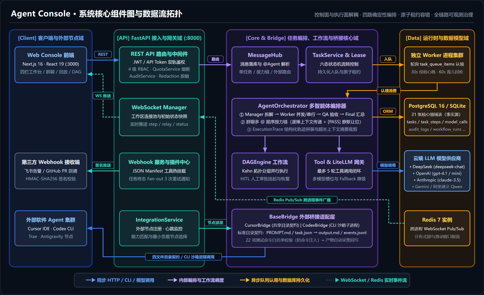

<details>
<summary><strong>📐 点击展开：Mermaid 架构源码版（可编辑）</strong></summary>

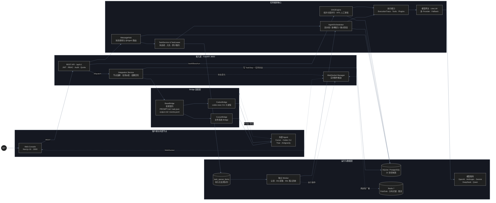

</details>

---

## 🚀 快速开始

### 方式一：Windows 全容器一键启动（推荐）

确保已安装并启动 Docker Desktop，在项目根目录直接双击运行 `start.bat`（或执行 `pwsh -File start.ps1`）：
- 自动复制生成 `.env` 配置文件；
- 按序拉起 `db`（PostgreSQL 16）、`redis`（Redis 7）、`migrate`（独占执行 `alembic upgrade head` 迁移容器，杜绝多进程并发建表冲突）、`backend`（`:8000`）、`worker`（独立队列消费进程）与 `frontend`（`:3000`）；
- 自动轮询 `/api/v1/health` 健康检查并在就绪后打开浏览器访问 [http://localhost:3000](http://localhost:3000)。

### 方式二：本地混合桥接启动（需调用宿主机 Codex CLI 时选用）

双击运行 `start-local.bat`：
- 自动在 Docker 中启动 `PostgreSQL` 与 `Redis`（若未安装 Docker 则自动平滑降级至本地 SQLite `backend/data/agent_console.db`）；
- 在宿主机独立终端窗口分别拉起 `Backend (:8000)`、`Worker` 与 `Frontend (:3000)`，方便后端直接调用宿主机安装的 `@openai/codex` CLI 与本地桥接目录。

### 方式三：手动三终端开发调试启动

```bash
# 终端 1：启动 FastAPI 接入层 (:8000)
cd backend
pip install -r requirements.txt -c constraints.txt
python -m uvicorn app.main:app --reload --port 8000

# 终端 2：启动独立持久化队列消费 Worker
cd backend
python -m app.worker

# 终端 3：启动 Next.js 前端控制台 (:3000)
cd frontend
npm install
npm run dev
```

打开浏览器访问 [http://localhost:3000](http://localhost:3000)。

### 🔑 预置演示账号与一键体验指令

若已导入演示数据，可直接使用以下四级 RBAC 账号登录（统一密码均为 `Report@123456`）：

| 角色等级 | 登录邮箱（账号） | 显示名称 | 权限范围说明 |
| :--- | :--- | :--- | :--- |
| **Owner（所有者）** | `chenming@agentconsole.dev` | 陈明（架构负责人） | 拥有工作区全部权限（成员管理、配额熔断、插件、工作流、HITL 审批） |
| **Admin（管理员）** | `liwei@agentconsole.dev` | 李薇（研发主管） | 管理成员、配额、插件、工作流模板及在线审批放行高危节点 |
| **Member（研发成员）** | `zhanghao@agentconsole.dev` | 张浩（后端开发） | 发起群聊派单、多棒接力、触发工作流与使用回放调试器 |
| **Viewer（观察者）** | `zhoumin@agentconsole.dev` | 周敏（质量审计） | 只读浏览群聊、任务回放、成本大屏与操作审计流水（写操作返回 `403`） |

登录后可在 **群聊（`/chats`）** 直接粘贴体验 3 棒顺序接力 + 工具调用：

```text
@项目总设计师 @Agent工程师 @测试专员 请接力完成支付回调幂等锁方案设计、系统状态探针自检与并发回归验收
```

---

## 🤖 预设 6 大专业智能体编队与协同机制

系统首次启动时通过幂等种子服务初始化 6 位职责互补的专业智能体，每位智能体绑定一个逻辑模型槽位（可在 `config/models.yaml` 或 `/settings` 在线映射至具体大模型）：

| 智能体名称 | 角色标识 (`role`) | 绑定模型槽位 | 核心职责边界 |
| :--- | :--- | :--- | :--- |
| **项目总设计师** | `project_architect` | `manager_model` | 需求拆解、技术架构设计、子任务分派与最终交付结果整合 |
| **Agent工程师** | `agent_engineer` | `code_model` | 后端核心逻辑实现、API 研发、Function Calling 工具调用与算法落地 |
| **前端设计师** | `frontend_designer` | `code_model` | 页面架构、响应式交互组件实现、视觉体验优化与无障碍适配 |
| **知识库管理员** | `knowledge_manager` | `writing_model` | 架构文档沉淀、接口契约整理、上下文检索维护与信息溯源 |
| **测试专员** | `qa_engineer` | `review_model` | 自动化测试编写、边界条件核查、集成回归验证与质量准出把关 |
| **运维** | `operations_engineer` | `code_model` | 容器化编排、CI/CD 流水线、数据库迁移审计、监控告警与回滚预案 |

### 1. 经典多阶段协同流水线

当用户在群聊中直接发送复杂需求（未 `@` 特定业务角色或 `@项目总设计师`）时，自动触发四阶段流水线：

```text
用户 @项目总设计师 "重构订单模块幂等锁并完成安全验收"
    │
    ▼
[Stage 1] Manager 拆解  ──►  生成结构化子任务清单与验收标准
    │
    ▼
[Stage 2] Worker 执行   ──►  Agent工程师 / 前端设计师（支持工具调用循环与并发执行）
    │
    ▼
[Stage 3] QA 审查验收   ──►  测试专员对照验收标准逐项核查
    │
    ▼
[Stage 4] Manager 汇总  ──►  整合终版交付报告写回群聊 + 持久化完整 ExecutionTrace
```

### 2. 群聊多 Agent 顺序接力链（Multi-Agent Relay）

单条消息按出现顺序 `@` 多个内部 Agent 时，自动去重构建最多 **6 棒** 的顺序接力链：

```text
用户: "@项目总设计师 @Agent工程师 @测试专员 请接力完成支付回调幂等锁方案与验收"
    │
    ├──► 第 1 棒 [项目总设计师]：原始任务 + 执行轨迹            ──► 产出写回群聊（带「接力 1/3」徽标）
    ├──► 第 2 棒 [Agent工程师] ：原始任务 + 第 1 棒产出 + 轨迹   ──► 自动调用 get_system_status() ──► 产出写回群聊（「接力 2/3」）
    └──► 第 3 棒 [测试专员]    ：原始任务 + 前两棒产出 + 轨迹    ──► 产出写回群聊（「接力 3/3」，若无增量可回复 [PASS] 静默让位）
```

- **数据落库**：`tasks.relay_agent_ids_json` 记录接力序列，每一棒独立生成 `task_steps(relay_turn_n)`；
- **实时进度**：WebSocket 广播 `task.relay_progress`（`started / completed / passed / failed`），前端顶部悬浮渲染接力进度链。

### 3. DAG 分层并行工作流与 HITL 人工审批

- **拓扑排序与并发驱动**：`DAGEngine` 在执行前通过 Kahn 算法执行环路检测与拓扑分层，运行期对同层无依赖节点调用 `asyncio.gather` 并行推进；
- **人工审批挂起与恢复**：遇到 `type: "human_approval"` 节点时，任务状态自动切换为 `waiting_approval`，同时在群聊内联 `ActionCard` 与任务详情页暴露审批入口；管理员点击“通过”后无缝唤醒下游节点，点击“驳回”则立即终止后续分支并记录审计。

---

## 🔧 统一模型网关与工具调用 (Function Calling)

### 内置工具与插件热挂载

编排器内置最多 **5 轮** 受控 Function Calling 循环，每轮调用输入与结果均持久化为独立 `TaskStep`：

| 内置工具名 | 功能说明 | 安全机制 |
| :--- | :--- | :--- |
| `calculate` | 数学表达式与工程指标计算 | 基于 Python `ast` 语法树白名单安全求值，严禁 `eval` 任意代码执行 |
| `query_tasks` | 检索当前工作区历史任务状态与摘要 | 强制绑定当前任务所属 `workspace_id`，防止跨租户读取 |
| `get_agents` | 查询当前工作区智能体编队与在线负载 | 租户级隔离只读查询 |
| `get_system_status` | 巡检各模型供应商配置状态与网关健康度 | 仅返回布尔就绪状态，绝不暴露明文密钥 |

此外，**插件注册中心（`/settings/plugins`）** 支持上传标准 JSON Manifest 在线扩展外部工具，按工作区粒度启用后自动注入 Agent 工具列表，并通过带 `X-Agent-Console-Signature`（`HMAC-SHA256`）签名的 Webhook 安全调用外部服务。

### 模型容灾与密钥管理

- **优先级与加密**：在 `/settings` 录入的厂商 API Key 采用信封加密（`v1:` 前缀）落库，优先级高于环境变量（`DB > .env`），列表查询永不回传明文；
- **递归 Fallback 降级链**：当主模型遭遇超时、`429 RateLimit` 或 `5xx` 故障时，LiteLLM 网关自动沿 `fallback_model` 链切换备选模型并标记 `fallback_used: true`。

---

## 🔌 外部 Agent 软件接入 (Software Dock)

Software Dock 将 `Cursor`、`Codex CLI`、`Trae`、`Antigravity` 等外部编程软件注册为标准执行节点，纳入统一调度与审计：

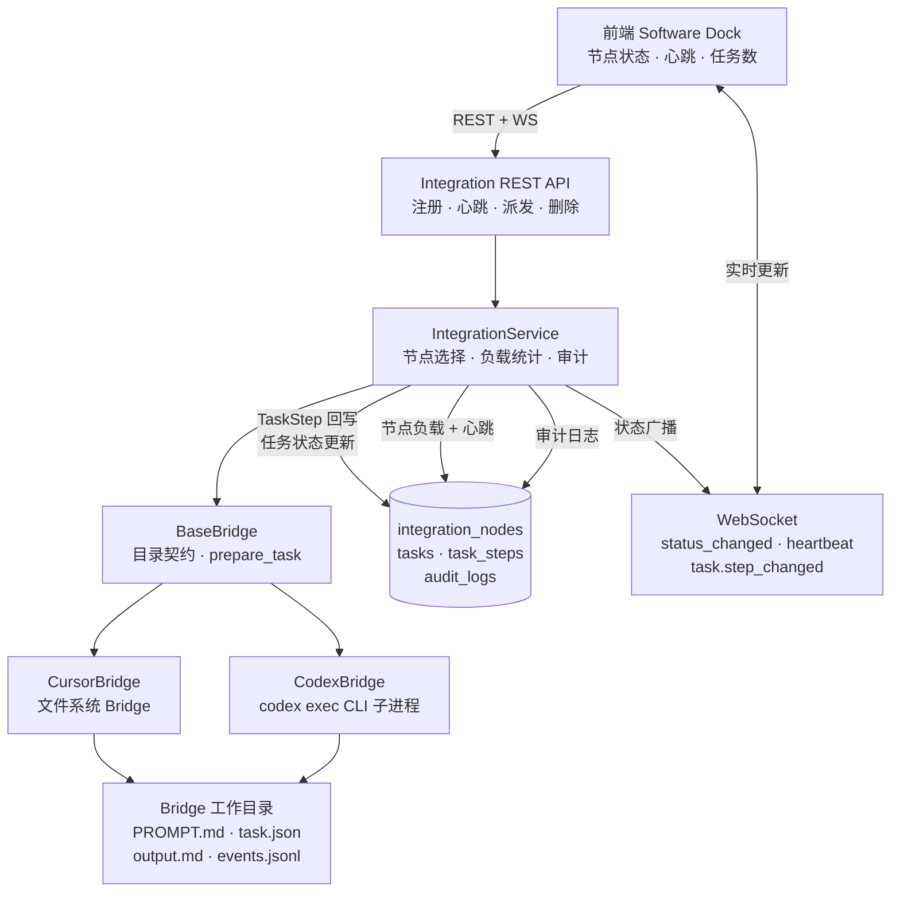

### Bridge 标准四文件目录契约

```text
data/bridges/
  workspace-<id>/
    Cursor/
      task-<task_id>/
        PROMPT.md        # 派发给外部 Agent 的任务描述与结构化上下文
        task.json        # 任务元数据与白名单测试命令契约
        output.md        # 外部 Agent 最终回写的交付文本
        events.jsonl     # 执行过程流式事件日志
    Codex/
      task-<task_id>/
        PROMPT.md · task.json · output.md · events.jsonl
```

---

## 🗄️ 数据库设计（21 张领域表）与迁移治理

系统持久层共包含 **21 张规范化关系型数据表**，完整覆盖多租户权限、持久队列租约、编排轨迹、模型计量、工作流快照与安全审计：

```text
workspaces              workspace_memberships    workspace_invitations
users                   refresh_tokens           agents
conversations           messages                 tasks
task_steps              task_queue_items         model_calls
provider_credentials    custom_model_configs     quota_configs
audit_logs              plugins                  workspace_plugins
workflow_templates      workflow_runs            integration_nodes
```

```bash
# 查看或生成 Alembic 迁移（在 backend/ 目录下）
alembic revision --autogenerate -m "describe_change"
alembic upgrade head
alembic downgrade -1

# 从 SQLite 一次性迁移数据至 PostgreSQL
python scripts/migrate_sqlite_to_pg.py --dry-run
python scripts/migrate_sqlite_to_pg.py
```

---

## 🛡️ 企业级安全、配额与治理

- **4 级 RBAC 权限矩阵**：服务端通过 `require_workspace_role` 强校验 `owner / admin / member / viewer` 角色，且所有业务接口强制注入服务端可信 `workspace_id`，严防水平越权；
- **预算水位与硬熔断（`QuotaService`）**：支持按工作区设定月度美元预算上限、月度 Token 上限、最大并发运行任务数及每分钟 API 请求速率（RPM）；开启 `is_hard_limit` 后超额请求立即返回 `429` 拦截；
- **全链路敏感内容脱敏（`Redaction`）**：任何消息、步骤日志与错误栈在落库及 WebSocket 广播前自动识别并遮蔽 `sk-` 密钥、`Bearer` 令牌与口令；
- **测试命令白名单防注入**：外部 Bridge 节点仅允许执行 `pytest`、`npm test`、`ruff`、`mypy` 等 22 项白名单命令前缀，拦截一切命令拼接注入。

---

## 🧪 自动化测试与质量门禁

```bash
# 后端单元与集成测试（46 个测试文件，320 项测试）
cd backend
python -m pytest tests/ -q

# 前端测试、类型检查、代码规范与生产构建（7 个测试文件，81 项测试）
cd frontend
npm test
npm run typecheck
npm run lint
npm run build

# 本地一键运行完整 CI 等价门禁
pwsh -NoProfile -File scripts/ci-local.ps1
```

当前质量门禁基线：**后端 320 passed，前端 81 passed / typecheck 0 error / lint 0 error / build pass**。

---

## ⚙️ 核心环境变量配置（`.env`）

复制 `.env.example` 为 `.env`，按需配置：

```bash
# 模型厂商 API Key（任填一个即可启动，也可启动后在前端 /settings 页面可视化录入）
DEEPSEEK_API_KEY=sk-xxx
OPENAI_API_KEY=sk-xxx
ANTHROPIC_API_KEY=
GEMINI_API_KEY=
DASHSCOPE_API_KEY=

# 数据库与 Redis 连接（Docker 模式由 docker-compose.yml 自动注入 PostgreSQL 与 Redis）
DATABASE_URL=sqlite+aiosqlite:///./data/agent_console.db
REDIS_URL=redis://localhost:6379/0

# 任务调度与安全治理开关
TASK_EXECUTION_MODE=queue       # queue: 独立 Worker 进程消费持久化队列；inline: API 进程内执行
WORKER_CONCURRENCY=2            # 单个 Worker 进程最大并发任务槽位数
WORKER_LEASE_RENEW_INTERVAL_SECONDS=30
WORKER_RECOVER_INTERVAL_SECONDS=60
AGENT_TOOLS_ENABLED=true        # 开启 Function Calling 工具循环
AGENT_MAX_TOOL_ITERATIONS=5     # 单阶段工具调用循环轮次上限（1-20）
CONTENT_REDACTION_ENABLED=true  # 落库与广播前自动正则脱敏敏感凭证
```

---

## 📂 项目工程结构

```text
├── Agent_Console_项目运行实况演示.mp4   # 1080p Full HD 24fps 项目全链路运行实况演示视频
├── backend/
│   ├── app/
│   │   ├── agents/                     # Manager / Worker / QA / Relay 智能体实现与工具循环
│   │   ├── api/                        # REST 路由控制器（auth / workspaces / tasks / workflows / governance ...）
│   │   ├── core/                       # AgentOrchestrator / MessageHub / ExecutionTrace / Redaction / RBAC
│   │   ├── db/                         # AsyncSession 引擎、事务辅助与幂等种子数据初始化
│   │   ├── models/                     # 21 张 SQLAlchemy 2.0 领域模型定义
│   │   ├── schemas/                    # Pydantic v2 请求与响应契约
│   │   ├── services/                   # DAGEngine / TaskService / TaskLease / LiteLLM / Quota / Audit / Bridges
│   │   ├── websocket/                  # WebSocket 连接池、事件信封与 Redis Pub/Sub 跨进程总线
│   │   └── worker.py                   # 独立持久化队列消费 Worker 进程入口
│   ├── alembic/                        # Alembic 数据库版本化迁移脚本
│   ├── tests/                          # 46 个后端自动化测试套件（320 tests）
│   ├── requirements.txt                # 后端直接依赖清单
│   └── constraints.txt                 # 生产与 CI 依赖精确版本锁
├── frontend/
│   ├── src/
│   │   ├── app/                        # Next.js 16 App Router 13 个核心业务视图路由
│   │   ├── components/
│   │   │   ├── chat/                   # 群聊消息流、@MentionChip、多棒接力进度、ActionCard 人工审批卡
│   │   │   ├── console/                # 四栏工作台、导航轨、团队列、Software Dock、DetailsPanel、BotMark
│   │   │   ├── settings/               # 设置中心、4 主题外观切换、模型密钥与降级链配置
│   │   │   └── workflows/              # 工作流模板卡片与 SVG 拓扑分层 DAG 画布
│   │   ├── hooks/                      # WebSocket 自动重连、群聊状态机、主题偏好等自定义 Hooks
│   │   ├── lib/                        # 401 自动刷新请求客户端、接力链解析与纯函数工具库
│   │   └── types/                      # 前后端契约对齐的 TypeScript 类型定义
│   └── package.json
├── config/
│   └── models.yaml                     # 逻辑模型槽位映射与 Fallback 降级链配置
├── docs/
│   ├── media/                          # README 实况动图预览与新版 DS-Bot 高清界面截图
│   ├── prd/                            # 35 份模块化产品需求文档（PRD）
│   ├── architecture-dark.png           # 系统全局深色架构图
│   └── check_docs_consistency.py       # PRD 文档索引一致性检查脚本
├── scripts/
│   ├── ci-local.ps1                    # 本地与 GitHub Actions 完全等价的质量门禁脚本
│   └── migrate_sqlite_to_pg.py         # SQLite 到 PostgreSQL 跨库数据迁移工具
├── docker-compose.yml                  # 生产级 6 服务容器编排（db / redis / migrate / backend / worker / frontend）
├── start.bat / start.ps1               # Windows 全容器一键启动脚本
└── start-local.bat                     # 本地混合桥接启动脚本
```

---

## 📄 License

本项目基于 [MIT License](LICENSE) 开源。
